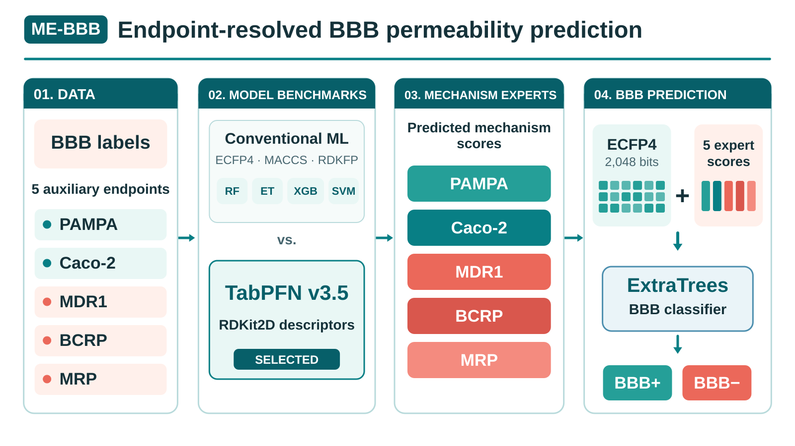

# ME-BBB: Endpoint-Resolved Mechanistic Attribution for Blood–Brain Barrier Permeability Prediction

[中文说明](README_zh-CN.md) · [Workflow](docs/workflow.md) · [Environment](docs/environment.md) · [Input data guide](data/README.md) · [Model acquisition](models/README.md) · [Zenodo model weights](https://doi.org/10.5281/zenodo.23908803) · [Third-party licenses](THIRD_PARTY_NOTICES.md)

ME-BBB integrates an ECFP4/Morgan radius-2 fingerprint (2,048 bits) with five transport/permeability expert probability scores for **BCRP, MDR1, MRP, PAMPA, and Caco-2**. Each expert uses TabPFN 3.5 with RDKit2DNormalized descriptors; an ExtraTrees classifier combines the five predictions with the molecular fingerprint for BBB permeability classification. The research workflow uses predefined Bemis–Murcko scaffold partitions.

## Graphical abstract



[View or download the editable SVG](assets/ME_BBB_graphical_abstract.svg).

## Contents

This is a **code-and-data release**. It contains published molecular datasets, predefined scaffold partitions, derived expert scores, ablation tables and SHAP attribution caches, as well as Python scripts for mechanistic-expert training, baseline comparison, BBB model fitting, feature ablation, and manuscript Figures 2–6, plus configuration and basic smoke tests. The public data files are available in [`data/`](data/README.md), including all ten BBB train/validation/test partitions and all five expert scaffold collections. **Pretrained TabPFN checkpoints, fitted model weights, and manuscript figure outputs are not bundled**; the fitted model artifacts are linked at [Zenodo DOI: 10.5281/zenodo.23908803](https://doi.org/10.5281/zenodo.23908803). Reproducing model fitting still requires compatible dependencies and externally obtained authorized weights. Source and cached data availability alone does not establish full numerical reproducibility.

## Repository map

| Task | Script |
| --- | --- |
| TabPFN expert model selection | `scripts/train_experts/tune_tabpfn_experts.py` |
| Train full-data mechanistic experts | `scripts/train_experts/train_full_tabpfn_experts.py` |
| Classical-model expert comparison | `scripts/train_experts/tune_classical_experts.py` |
| Expert model evaluation | `scripts/train_experts/evaluate_selected_experts.py` |
| BBB model training and tuning | `scripts/train_bbb/tune_and_train_bbb.py` |
| Feature ablation | `scripts/analyses/ablation/run_ablation.py` |
| Manuscript Figures 2–6 | `scripts/figures/figure2/` through `scripts/figures/figure6/` |

## Zenodo model weights

The five fitted TabPFN 3.5 mechanistic expert models and final BBB ExtraTrees classifier are archived separately from GitHub. **Zenodo DOI:** [10.5281/zenodo.23908803](https://doi.org/10.5281/zenodo.23908803). The upstream TabPFN 3.5 checkpoint is a separate dependency governed by Prior Labs' license. Refer to [models/README.md](models/README.md) for licensing and download information.

The DOI was supplied by the depositor. Individual files, public download URLs, file sizes, and SHA-256 checksums have not yet been independently verified; consequently, automated model downloads are not enabled in the manifest.

## Computational environments

The workflow used **two distinct Conda environments**. The following are installed versions captured in the author's November 2026 audits, **not historical dependency lockfiles**:

| Component | Conventional ML, BBB ExtraTrees, SHAP and plots (`base`) | TabPFN experts (`tabpfn35`) |
| --- | --- | --- |
| Python | 3.13.9 | 3.11.17 |
| scikit-learn | 1.6.1 | 1.9.1 |
| RDKit | 2025.09.3 | 2026.09.1 |
| TabPFN | Not installed | 9.2.0 (ModelVersion.V3_5) |
| XGBoost | 3.1.2 | Not installed |
| SHAP | 0.51.0 | Not installed |
| PyTorch | 2.9.1+cu128 | 2.7.1+cu118 |
| PyTorch CUDA build | 12.8 | 11.8 |

The conventional ML / analysis workflow ran mainly on CPU despite the CUDA-capable PyTorch installation. Both environments were observed on a machine with 2 × Tesla T4 GPUs and NVIDIA driver 580.95.05. See [complete environment provenance](docs/environment.md) and the [machine-readable audit](configs/audited_environments.json). Historical experiment-level dependency locks were not available in the audits.

## Getting started

```bash
conda env create -f environment.yml
conda activate me-bbb-dev
python -m unittest discover -s tests -v
```

The installation above is a **convenience development and smoke-test environment**, not either audited research environment. It excludes TabPFN. For the expert workflow, use a **separate Python 3.11 environment** and install `requirements/tabpfn.txt` with an appropriate GPU-enabled PyTorch build and access the official TabPFN 3.5 checkpoint under its own license. `torch==2.7.1+cu118` describes the supplied machine; do not assume a generic `pip install torch` reproduces that build. See [the upstream PyTorch install guide](https://pytorch.org/get-started/previous-versions/) for platform-specific wheels and [Prior Labs](https://huggingface.co/Prior-Labs/tabpfn_3_5) for official checkpoint access.

To inspect script interfaces after installing dependencies:

```bash
python scripts/train_bbb/tune_and_train_bbb.py --help
python scripts/train_experts/tune_tabpfn_experts.py --help
python scripts/figures/figure4/plot_figure4.py --help
```

The scripts expect data files laid out as described in [data/README.md](data/README.md). Outputs default to `outputs/` (excluded from version control).

## License and citation

The repository's original code is distributed under the project [MIT license](LICENSE). This **does not relicense** TabPFN 3.5 weights or derivatives, third-party packages, molecular data, or separately restricted model outputs. TabPFN 3.5 is obtained from its official provider under a separate non-commercial license; see [third-party notices](THIRD_PARTY_NOTICES.md). Formal paper citation and DOI will be added when available.
