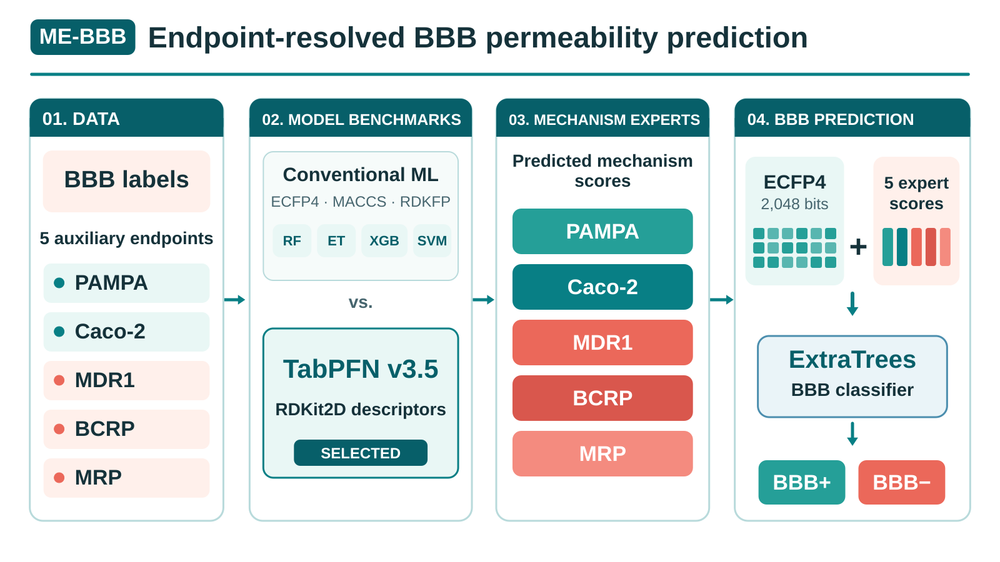

# ME-BBB：机制增强的血脑屏障通透性预测

[English README](README.md) · [工作流程](docs/workflow.md) · [环境信息](docs/environment.md) · [数据输入](data/README.md) · [Zenodo 模型权重](https://doi.org/10.5281/zenodo.23908803) · [第三方许可](THIRD_PARTY_NOTICES.md)

ME-BBB 使用 **ECFP4（Morgan radius 2，2048 bit）** 和五个机制专家（BCRP、MDR1、MRP、PAMPA、Caco-2）的预测概率，建立基于 ExtraTrees 的 BBB 分类模型。机制专家以 RDKit2DNormalized 描述符和 TabPFN 3.5 为基础，使用预定义的 Bemis–Murcko 骨架划分。

## 图文摘要（Graphical abstract）



[查看或下载可编辑 SVG 原文件](assets/ME_BBB_graphical_abstract.svg)。

## 本次公开内容

这是**代码与研究数据公开版**，包含训练专家模型、传统算法对照、BBB 模型训练、消融实验及 Figure 2–6 绘图代码；`data/` 目录已公开参考数据、BBB 的十组 train/validation/test scaffold 划分、五个机制端点的 scaffold 划分、专家预测分数及部分图表缓存。**拟合模型权重、TabPFN checkpoint 和最终图件输出尚未随仓库提供**，模型权重对应 [Zenodo DOI：10.5281/zenodo.23908803](https://doi.org/10.5281/zenodo.23908803)。完整重训仍需匹配的运行环境和合法取得的权重，不能仅凭目录齐全认定已经完整复现论文结果。

## Zenodo 模型权重

五个 TabPFN 3.5 机制专家及最终 BBB ExtraTrees 模型归档于 Zenodo：[**10.5281/zenodo.23908803**](https://doi.org/10.5281/zenodo.23908803)。GitHub 不包含拟合后的模型文件；TabPFN 官方基础权重需遵守 Prior Labs 许可证单独获取。详情见 [模型获取说明](models/README.md)。

DOI 由上传者提供；目前尚未独立核实公开文件清单、直接下载地址、大小及 SHA-256，所以模型清单中的自动下载仍保持待验证状态。

## 计算环境

ME-BBB 实际使用**两套独立的 Conda 环境**。下列版本来自 2026 年 11 月服务器环境审计，并非每次历史实验的精确依赖锁定文件。

| 软件 | `base`：传统 ML / BBB / SHAP / 绘图 | `tabpfn35`：TabPFN 专家 |
| --- | --- | --- |
| Python | 3.13.9 | 3.11.17 |
| scikit-learn | 1.6.1 | 1.9.1 |
| RDKit | 2025.09.3 | 2026.09.1 |
| TabPFN | 未安装 | 9.2.0（ModelVersion.V3_5） |
| XGBoost | 3.1.2 | 未安装 |
| SHAP | 0.51.0 | 未安装 |
| PyTorch | 2.9.1+cu128 | 2.7.1+cu118 |
| PyTorch CUDA 构建版本 | 12.8 | 11.8 |

传统机器学习和 SHAP 等分析主要在 CPU 上执行；`base` 虽然安装了支持 CUDA 的 PyTorch，但不能据此认定这些分析使用了 GPU。两套环境所在服务器均报告 2 张 Tesla T4 显卡和 NVIDIA 580.95.05 驱动。详细依赖及溯源信息参见 [环境文档](docs/environment.md) 和 [环境审计 JSON](configs/audited_environments.json)。

## Getting started：按任务选择环境

下列命令是**便于安装和测试的参考方案**，并非对你原始 `base` 和 `tabpfn35` 环境的精确锁定复刻。实际环境版本与分工见 [环境说明](docs/environment.md)。

### 1. 仓库基础检查（无需 GPU 或模型权重）

```bash
git clone https://github.com/wangze09/ME-BBB.git
cd ME-BBB
conda env create -f environment.yml
conda activate me-bbb-dev
python -m unittest discover -s tests -v
```

`me-bbb-dev` 是便利的开发与测试环境（Python 3.11），**不是论文使用的两套实际研究环境之一**。上述检查不代表重训模型或复现论文全部数值。

### 2. 传统机器学习、最终 BBB、SHAP 与绘图

```bash
conda create -n me-bbb-analysis python=3.13 -y
conda activate me-bbb-analysis
python -m pip install -r requirements/figures.txt
python scripts/train_bbb/tune_and_train_bbb.py --help
python scripts/figures/figure4/plot_figure4.py --help
```

该安装方案对应原始 `base` 环境的用途，审计版本为 Python 3.13.9、scikit-learn 1.6.1、RDKit 2025.09.3 和 SHAP 0.51.0。**依赖没有锁定版本**，不能保证安装结果与审计环境完全相同。BBB/SHAP 阶段读取已导出的五个专家分数 CSV，通常不需要在该环境中安装 TabPFN。

### 3. 五个 TabPFN 3.5 机制专家（单独 GPU 环境）

```bash
conda create -n me-bbb-tabpfn python=3.11 -y
conda activate me-bbb-tabpfn
# 如需使用 GPU，先安装与服务器 CUDA/驱动兼容的 PyTorch
python -m pip install -r requirements/tabpfn.txt
python scripts/train_experts/tune_tabpfn_experts.py --help
```

此方案对应 `tabpfn35` 环境的用途，审计版本为 Python 3.11.17、TabPFN 9.2.0、RDKit 2026.09.1 和 PyTorch 2.7.1+cu118。普通 `pip install torch` **不保证**获得相同的 CUDA 构建；请参考 [PyTorch 官方安装指南](https://pytorch.org/get-started/locally/) 并从 [Prior Labs](https://huggingface.co/Prior-Labs/tabpfn_3_5) 合法获取 TabPFN 3.5 权重。

主脚本位于 `scripts/train_experts/`、`scripts/train_bbb/`、`scripts/analyses/ablation/` 和 `scripts/figures/`。输入约定见 [data/README.md](data/README.md)，模型说明见 [models/README.md](models/README.md)。原始代码按仓库 MIT 许可证发布，但 TabPFN 权重、模型输出和第三方数据不受项目 MIT 许可证覆盖。
